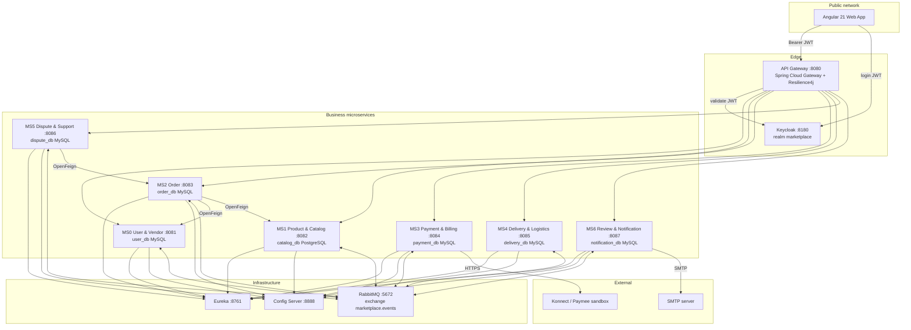

# ShopyTn

**Multi-vendor e-commerce marketplace for Tunisia** — academic intermediate validation project (conception / architecture phase).

> **Important:** As of this documentation, the repository contains **design and PDF documentation only**. The `Backend/` and `Frontend/` directories exist but contain **no application source code**. Everything below that describes microservices, APIs, ports, and run commands is taken from project PDFs and is **planned**, not verified in runnable code.

---

## 1. Project Title

**ShopyTn** (also labeled **SoukTn** in several UML diagrams)

Marketplace E-Commerce Multi-Vendeurs — Tunisian modular marketplace built around a distributed microservices architecture.

---

## 2. Project Overview

ShopyTn aims to connect **buyers**, **local merchants**, and **delivery agents** in a single digital marketplace. The documented solution replaces a monolithic design with autonomous domain services, an API Gateway, service discovery, identity management (Keycloak), and mixed synchronous / asynchronous communication.

The current workspace state corresponds to **Sprint 1 (Conception)**: requirements analysis, global architecture, UML diagrams, API contracts, and team organization — without implemented services yet.

---

## 3. Project Objectives

- Provide a national multi-vendor marketplace adapted to the Tunisian e-commerce context.
- Decompose the platform into independently deployable microservices (users, catalog, orders, payment, logistics, disputes, reviews/notifications).
- Centralize client access through an API Gateway and discover services with Eureka.
- Combine REST/OpenFeign (synchronous) and RabbitMQ topic events (asynchronous).
- Integrate Tunisian payment sandboxes (Konnect / Paymee) or an internal payment mock for academic tests.
- Support role-based access for Client, Vendor, Admin, and Delivery actors.

---

## 4. Main Features (Documented / Planned)

| Domain | Planned capabilities |
|---|---|
| Accounts & authorization | Registration, Keycloak JWT login, RBAC (`CLIENT`, `VENDOR`, `ADMIN`, `DELIVERY`) |
| Multi-vendor catalog | Products, categories, images, stock, search/filter |
| Cart & orders | Cart management, checkout, status lifecycle |
| Payment & billing | Sandbox/mock payment, invoices, refunds after disputes |
| Logistics | Delivery assignment, tracking events, status updates |
| Reviews & notifications | Product reviews after delivery, email + in-app notifications |
| Disputes & returns | RMA/disputes with Spring StateMachine workflow |

---

## 5. Technologies and Tools

Verified from `Documentation/ShopyTn.pdf` and the intermediate validation presentation:

| Layer | Planned stack |
|---|---|
| Backend | Java 21, Spring Boot 3.x, Spring Cloud (Gateway, Eureka, OpenFeign), Spring Security, Spring Data, Resilience4j, Spring StateMachine (disputes) |
| Frontend | Angular 21, Bootstrap and/or Angular Material / Tailwind CSS (presentation mentions Bootstrap + TailwindCss) |
| Identity | Keycloak (realm `marketplace`), JWT validation at the gateway |
| Databases | MySQL (most business services), PostgreSQL (`catalog_db`, Keycloak DB); older technical PDF also mentions MongoDB for catalog/notifications |
| Messaging | RabbitMQ topic exchange `marketplace.events` (Kafka listed as alternative in earlier docs) |
| Config / discovery | Eureka Server `:8761`, Spring Cloud Config Server `:8888` |
| Deployment | Docker, Docker Compose, private network `marketplace-net` |
| Payments | Konnect / Paymee sandbox + internal mock |
| Email | External SMTP server |

---

## 6. System Architecture

### High-level design (from architecture slide)

- **Client:** Angular 21 SPA → public network.
- **Edge:** Spring Cloud Gateway `:8080` (only business HTTP port exposed to clients) + Keycloak `:8180`.
- **Discovery / config:** Eureka `:8761`, Config Server `:8888` (Git `config-repo`).
- **Business services:** MS0–MS6, each with its own database (database-per-service).
- **Broker:** RabbitMQ `:5672` (management UI `:15672`).
- **External:** Konnect/Paymee (HTTPS), SMTP.

**Documented startup order (Discovery First):** Eureka → Config Server → Keycloak, RabbitMQ, databases → microservices → API Gateway.

---

## 7. Architecture Diagram (Mermaid)



---

## 8. Project Folder Structure

**Actual structure present in this workspace:**

```text
ShopyTn/
├── Backend/                          # EMPTY — no microservice source code
├── Frontend/                         # EMPTY — no Angular application
├── Documentation/
│   ├── ShopyTn.pdf                   # Technical document (intermediate validation)
│   ├── Presenation/                  # Folder name typo: "Presenation"
│   │   └── ShopyTn Preseantatio.pdf  # 44-page presentation (filename typo)
│   └── Diagrams/
│       ├── 1.pdf … 6.pdf
│       ├── 7                         # Truncated/corrupt PDF (no extension, incomplete)
│       ├── 8.pdf … 17.pdf            # Extracted UML / interaction slides
│       └── 18.pdf                    # Near-duplicate of the full presentation
└── README.md                         # This file
```

**Proposed repository layout** (from the technical PDF — **not created** in this workspace):

```text
eCommerce-4das16-gX/
├── Backend/
│   ├── api-gateway/
│   ├── discovery-server/
│   ├── user-service/
│   ├── catalog-service/
│   ├── order-service/
│   ├── payment-service/
│   ├── delivery-service/
│   ├── notification-service/
│   └── dispute-service/
├── Frontend/
│   └── ecommerce-web-app/
├── Documentation/
├── docker-compose.yml
└── README.md
```

### Purpose of important folders

| Path | Purpose |
|---|---|
| `Backend/` | Intended home for Spring Boot microservices and infrastructure services — currently empty |
| `Frontend/` | Intended home for the Angular 21 web application — currently empty |
| `Documentation/` | Project PDFs for intermediate academic validation |
| `Documentation/Diagrams/` | Individual UML/use-case/architecture diagram exports |
| `Documentation/Presenation/` | Full team presentation deck |

---

## 9. Microservices Description

> Ports, Eureka names, databases, and responsibilities below come from the **architecture / class / API contract slides**. They are **not** confirmed by running services in this repository.

| Microservice | Port | Eureka name | Technology | Database | Responsibilities | Communication |
|---|---|---|---|---|---|---|
| API Gateway | 8080 | — | Spring Cloud Gateway, Resilience4j | — | Single HTTP entry, routing, JWT filter | HTTP to all services via `lb://` |
| Eureka Server | 8761 | — | Spring Cloud Netflix Eureka | — | Service registry / heartbeat | Discovery |
| Config Server | 8888 | — | Spring Cloud Config | Git config-repo | Centralized configuration | Discovery-first load |
| Keycloak | 8180 | — | Keycloak IAM | `keycloak_db` (PostgreSQL) | Login, JWT, roles, Admin API used by MS0 | HTTPS / OIDC |
| RabbitMQ | 5672 / 15672 | — | RabbitMQ | — | Async domain events (`marketplace.events`) | AMQP |
| **MS0** User & Vendor | 8081 | `USER` | Spring Boot | `user_db` (MySQL)* | Profiles, addresses, shops, vendor validation | Publishes `USER_REGISTERED`; called by MS2; calls Keycloak Admin |
| **MS1** Product & Catalog | 8082 | `CATALOG` | Spring Boot | `catalog_db` (PostgreSQL) | Categories, products, images, stock, search | Called by MS2; consumes `PAYMENT_COMPLETED` to decrease stock |
| **MS2** Order | 8083 | `ORDER` | Spring Boot | `order_db` (MySQL) | Cart, orders, order lifecycle | OpenFeign → MS0/MS1; publishes `ORDER_*`; consumes payment/delivery events |
| **MS3** Payment & Billing | 8084 | `PAYMENT` | Spring Boot | `payment_db` (MySQL) | Payments, invoices, refunds | Calls Konnect/Paymee; publishes `PAYMENT_*`; consumes order/dispute events |
| **MS4** Delivery & Logistics | 8085 | `DELIVERY` | Spring Boot | `delivery_db` (MySQL) | Assignment, tracking, delivery statuses | Consumes `PAYMENT_COMPLETED`; publishes `DELIVERY_UPDATED` |
| **MS5** Dispute & Support | 8086 | `DISPUTE` | Spring Boot + StateMachine | `dispute_db` (MySQL) | Disputes, returns, evidence, messages | OpenFeign → MS2; publishes `DISPUTE_RESOLVED` |
| **MS6** Review & Notification | 8087 | `NOTIFICATION` | Spring Boot | `notification_db` (MySQL)** | Reviews, PurchaseRecord, notifications | Consumes many events; sends SMTP email |

\* One presentation slide briefly lists PostgreSQL for the common user/vendor stack; the detailed class diagram and architecture slide specify **MySQL `user_db`**.  
\*\* The older technical PDF listed **MongoDB** for Review & Notification and Product & Catalog; the later presentation/class diagrams specify **MySQL** / **PostgreSQL** as above.

### Gateway route map (documented)

| Path pattern | Target |
|---|---|
| `/api/users/**`, `/api/vendors/**` | `lb://USER` |
| `/api/products/**`, `/api/categories/**` | `lb://CATALOG` |
| `/api/cart/**`, `/api/orders/**` | `lb://ORDER` |
| `/api/payments/**`, `/api/invoices/**` | `lb://PAYMENT` |
| `/api/deliveries/**` | `lb://DELIVERY` |
| `/api/disputes/**`, `/api/returns/**` | `lb://DISPUTE` |
| `/api/reviews/**`, `/api/notifications/**` | `lb://NOTIFICATION` |

---

## 10. Database Architecture

Documented pattern: **one database per microservice**, references across services by **IDs only** (no cross-service foreign keys).

| Database | Engine (presentation) | Owning service | Main entities (from class diagrams) |
|---|---|---|---|
| `user_db` | MySQL | MS0 | `User`, `Address`, `Shop` |
| `catalog_db` | PostgreSQL | MS1 | `Category`, `Product`, `ProductImage` (`attributes` as JSONB) |
| `order_db` | MySQL | MS2 | `Cart`, `CartItem`, `Order`, `OrderItem` |
| `payment_db` | MySQL | MS3 | `Payment`, `Invoice`, `InvoiceLine`, `Refund` |
| `delivery_db` | MySQL | MS4 | `Delivery`, `TrackingEvent` |
| `dispute_db` | MySQL | MS5 | `Dispute`, `DisputeMessage`, `Evidence` |
| `notification_db` | MySQL | MS6 | `Review`, `PurchaseRecord`, `Notification`, `NotificationTemplate` |
| `keycloak_db` | PostgreSQL | Keycloak | Keycloak internal schema |

---

## 11. Communication Between Components

### Synchronous (OpenFeign / HTTP)

- MS2 → MS0 `GET /api/users/{id}` (shipping address)
- MS2 → MS1 `GET /api/products/{id}` (price, stock, active)
- MS5 → MS2 `GET /api/orders/{id}` (dispute eligibility)
- MS0 → Keycloak Admin API (account create/role/suspend)
- MS3 → Konnect/Paymee sandbox
- MS6 → SMTP

### Asynchronous (RabbitMQ `marketplace.events`)

| Event | Publisher | Main consumers (documented) |
|---|---|---|
| `USER_REGISTERED` | MS0 | MS6 (welcome notification) |
| `ORDER_CREATED` | MS2 | MS3 (payment + draft invoice) |
| `ORDER_CANCELLED` | MS2 | MS3, MS6 |
| `PAYMENT_COMPLETED` | MS3 | MS2, MS1, MS4, MS6 |
| `PAYMENT_FAILED` | MS3 | MS2, MS6 |
| `DELIVERY_UPDATED` | MS4 | MS2, MS6 |
| `DISPUTE_RESOLVED` | MS5 | MS3 (refund), MS6 |

> Naming note: some overview slides still say `PAYMENT_SUCCESS` / `DELIVERY_COMPLETED`, while detailed contracts standardize on `PAYMENT_COMPLETED` / `DELIVERY_UPDATED`.

### Main business process (order happy path)

1. Client browses catalog (Angular → Gateway → MS1).
2. Client manages cart and places order (MS2 validates via MS0/MS1, publishes `ORDER_CREATED`).
3. MS3 creates pending payment + draft invoice, client checks out via sandbox.
4. On success, MS3 publishes `PAYMENT_COMPLETED` → order confirmed, stock decreased, delivery created, notifications sent.
5. Admin assigns courier; MS4 publishes `DELIVERY_UPDATED` until `DELIVERED`.
6. Client may leave a review (MS6) or open a dispute (MS5).

---

## 12. API Documentation

Full endpoint contracts are defined in the presentation API slides (not implemented as OpenAPI/Swagger artifacts in this repository). Summary of documented surface:

### MS0 — User & Vendor (`:8081`)

Public registration, authenticated profile/addresses, vendor shop management, admin user/vendor moderation, internal `GET /api/users/{userId}`.

### MS1 — Product & Catalog (`:8082`)

Public product search/detail/categories; vendor product CRUD + stock/images; admin category management and product status.

### MS2 — Order (`:8083`)

Cart CRUD + merge; create/list/cancel orders; vendor received orders; admin order listing.

### MS3 — Payment & Billing (`:8084`)

Checkout, webhook, payment history, refunds listing; invoice list/detail/PDF; vendor sales lines.

### MS4 — Delivery (`:8085`)

Track by order/tracking number; agent status updates; admin assign/list.

### MS5 — Dispute (`:8086`)

Open dispute/return, evidence, messages; vendor respond; admin accept/reject/close; state machine transitions.

### MS6 — Review & Notification (`:8087`)

Public product reviews; create review after delivered purchase; in-app notification read APIs.

---

## 13. Installation Prerequisites

Because **no application code or `docker-compose.yml` is present**, the following are **planned** prerequisites from the documentation only:

- JDK 21
- Node.js / npm (for Angular 21 once the frontend is scaffolded)
- Docker & Docker Compose
- Git
- (Optional local tools) MySQL, PostgreSQL, RabbitMQ, Keycloak — or run them via Compose when available

---

## 14. Installation Instructions

**Current workspace:** nothing to install for the application itself.

Expected future steps (from documented structure, not executable today):

```bash
# After services and Compose files are added
git clone <repository-url>
cd ShopyTn

# Planned infrastructure bootstrap (file not present yet)
docker compose up -d

# Planned backend (per service)
cd Backend/<service-name>
./mvnw spring-boot:run

# Planned frontend
cd Frontend/ecommerce-web-app
npm install
npm start
```

---

## 15. Configuration and Environment Variables

**No `.env`, `application.yml`, or Config Server repository exists in this workspace.**

Documented configuration concepts to expect later:

- Keycloak realm `marketplace`, public keys used by the gateway
- Eureka registration names (`USER`, `CATALOG`, `ORDER`, `PAYMENT`, `DELIVERY`, `DISPUTE`, `NOTIFICATION`)
- RabbitMQ exchange `marketplace.events` and per-service queues (e.g. `catalog.payment-completed`, `delivery.payment-completed`)
- Database JDBC URLs for each `*_db`
- Payment provider sandbox credentials (must never be committed)
- SMTP credentials for MS6

Secrets are **not** present in the repository (nothing to redact).

---

## 16. Database Setup

Planned approach: provision one schema/database per service through Docker Compose.

Until Compose and Flyway/Liquibase (or JPA `ddl-auto`) scripts exist, **no database can be initialized from this repository**.

---

## 17. How to Run the Project

**Not runnable in the current state.**

Documented client entry points once implemented:

| Component | URL / port |
|---|---|
| Angular app | (not specified; typically `http://localhost:4200`) |
| API Gateway | `http://localhost:8080` |
| Keycloak | `http://localhost:8180` |
| Eureka | `http://localhost:8761` |
| Config Server | `http://localhost:8888` |
| RabbitMQ UI | `http://localhost:15672` |

---

## 18. How to Run Tests

**No test suites, CI workflows, or test folders were found.**

The technical PDF plans unit/integration tests in Sprint 4. Until code exists, there is nothing to execute.

---

## 19. PDF Documentation References

| File | Pages | Purpose |
|---|---|---|
| [`Documentation/ShopyTn.pdf`](Documentation/ShopyTn.pdf) | 9 | Technical document for intermediate validation: context, features, architecture, tech stack, team split, Git layout, sprints, risks, initial API/event contracts, open decisions |
| [`Documentation/Presenation/ShopyTn Preseantatio.pdf`](Documentation/Presenation/ShopyTn%20Preseantatio.pdf) | 44 | Main presentation: use cases, architecture, per-service class diagrams, interaction scenarios, detailed API contracts, planning |
| [`Documentation/Diagrams/18.pdf`](Documentation/Diagrams/18.pdf) | 44 | Near-duplicate of the presentation deck |
| [`Documentation/Diagrams/1.pdf`](Documentation/Diagrams/1.pdf)–[`17.pdf`](Documentation/Diagrams/17.pdf) | 1 each | Extracted slides (class diagrams, interactions, use cases); some duplicates |
| [`Documentation/Diagrams/7`](Documentation/Diagrams/7) | — | **Corrupt/truncated PDF** (`%PDF-1.7` header, missing EOF; unreadable) |

### Diagram index (verified titles)

| File | Content |
|---|---|
| `1.pdf`, `2.pdf` | MS6 Review & Notification (interactions / class model) |
| `3.pdf` | MS5 Dispute interactions |
| `4.pdf`–`6.pdf` | MS4 Delivery class diagram (duplicate exports) |
| `7` | Unreadable truncated file |
| `8.pdf` | MS3 Payment & Billing class diagram |
| `9.pdf`, `10.pdf` | MS2 Order interactions / class diagram |
| `11.pdf`, `12.pdf` | MS1 Product & Catalog interactions / class diagram |
| `13.pdf`, `14.pdf` | MS0 User & Vendor interactions / class diagram |
| `15.pdf` | Global class diagram (all 7 services) |
| `16.pdf`, `17.pdf` | Use-case diagram (duplicate exports) |
| `18.pdf` | Full presentation copy |

---

## 20. Current Implementation Status

| Functionality | Status | Implementation location | Description |
|---|---|---|---|
| Project documentation (PDF) | **Implemented** | `Documentation/` | Technical doc + presentation + diagram exports |
| Architecture design | **Implemented (docs)** | Presentation architecture slide | Microservices, ports, broker, gateway, Keycloak |
| UML class / use-case diagrams | **Implemented (docs)** | `Documentation/Diagrams/` | Per-service and global models |
| API contracts | **Documented only** | Presentation API slides | Detailed endpoints/roles/HTTP codes |
| Backend microservices | **Missing** | `Backend/` (empty) | No Java/Spring projects |
| API Gateway / Eureka / Config | **Missing** | — | No infrastructure modules |
| Frontend Angular app | **Missing** | `Frontend/` (empty) | No `package.json` / Angular workspace |
| Docker Compose / Dockerfiles | **Missing** | — | No container definitions |
| Databases / migrations | **Missing** | — | No schemas or seed data |
| Authentication integration | **Missing** | — | Keycloak described only |
| RabbitMQ consumers/publishers | **Missing** | — | Event names documented only |
| Payment sandbox integration | **Missing** | — | Konnect/Paymee planned |
| Automated tests / CI | **Missing** | — | Not present |
| Root README | **Implemented** | `README.md` | This file |
| Git repository | **Missing** | — | No `.git` directory in the workspace |

**Verdict:** the project is in a **documentation / design validation** stage. Functional implementation has not started in this tree.

---

## 21. Known Limitations

- Empty `Backend/` and `Frontend/` prevent any local run or API verification.
- No `docker-compose.yml`, despite Docker being a planned transversal responsibility.
- Dual naming (**ShopyTn** vs **SoukTn**) across documents.
- Internal inconsistencies between the 9-page technical PDF and the later presentation (databases, event names, team assignments, MongoDB vs SQL).
- `Documentation/Diagrams/7` is a broken PDF export.
- Folder/file typos: `Presenation/`, `ShopyTn Preseantatio.pdf`.
- No OpenAPI/Swagger artifacts committed yet (planned mitigation for API drift).
- No git history / remote configured in this workspace copy.

---

## 22. Future Improvements

Aligned with the documented sprint plan:

1. **Sprint 2:** Scaffold microservices, CRUD REST APIs, Eureka, Gateway, Compose databases.
2. **Sprint 3:** OpenFeign + RabbitMQ integration, payment sandbox/mock, Angular UI connection.
3. **Sprint 4:** Tests, security hardening, full containerization, defense/demo readiness.
4. Resolve open decisions listed in the technical PDF: final RDBMS choices, broker (RabbitMQ vs Kafka), Keycloak vs Spring Security split, payment mock vs sandbox, freeze API/event contracts.
5. Add OpenAPI specs, a root Compose file, and a real Gitflow (`main` / `develop` / `feature/*`) as described in documentation.

---

## 23. Contributors

Identified from project PDFs (spellings vary across slides):

| Name | Documented responsibility |
|---|---|
| Mohamed Rayen Sboui | Product & Catalog (+ Eureka in technical PDF) |
| Mohamed Aziz Mehrez | Order (+ API Gateway in technical PDF) |
| Mohamed Ezzidine Zouiten / Ezzidne Zouitten / Ezzidine Jbali | Payment & Billing (+ message broker in technical PDF) — naming inconsistent across slides |
| Dhia Jbali | Delivery & Logistics (+ Docker Compose in technical PDF) |
| Maryem / Myriam / Marime Slatni | Dispute & Customer Support (+ StateMachine) |
| Samer Mfarrej / Ben Maghzouz Ahmed | Review & Notification — **conflicting assignment** between presentation slides |
| Whole team | Common User & Vendor / authentication socle |

Canva metadata embedded in several diagram PDFs also lists a different authorship set (including Rayen Sboui as PDF author and other names in titles). Treat team membership above as **documentation-derived**, not as verified contribution history (no git commits available).

---

## Technical audit notes

- This README was generated after a full recursive inspection of the workspace.
- Only non-code artifacts found under `Documentation/`; `Backend/` and `Frontend/` contain zero files.
- Ports, Eureka names, databases, and endpoints are copied from PDF contracts and **could not be verified against running code**.
- Temporary investigation artifacts were removed after analysis; project application files were not modified.
